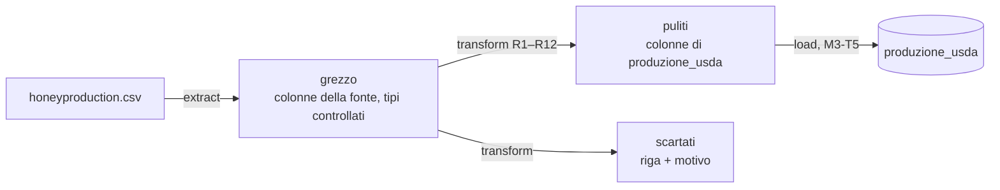

# M3 - T4 · ETL: extract e transform

> **Milestone** M3 · Accesso ai dati ed ETL
> **Task** M3-T4
> **Stato** completata
> **Commit** `feat(m3): add USDA ETL extract and transform`
> **Collegati** → [`dati.md`](../M2-dati/dati.md) (regole R1–R12) · [`M2-T2_dizionario_e_pulizia.md`](../M2-dati/M2-T2_dizionario_e_pulizia.md)

## Obiettivo

Leggere il CSV USDA e trasformarlo nei dati della tabella `produzione_usda`,
fallendo subito e in modo comprensibile se il file è sbagliato, e producendo dati
puliti e **spiegabili**: ogni riga scartata ha il suo motivo, e il motivo è una
delle regole di M2-T2.

## Descrizione

`beewatch/etl.py`:

```python
from pathlib import Path
from beewatch.etl import conteggio_scarti, extract, transform

grezzo = extract(Path("data/honeyproduction.csv"))
puliti, scartati = transform(grezzo)
conteggio_scarti(scartati)        # {} sul file vero: nessuna riga scartata
```



### `extract(percorso)`: la forma del file

Legge il CSV (UTF-8, anche con BOM) e controlla, nell'ordine:

| Controllo | Errore |
|---|---|
| il file esiste | `ETLError`: dove scaricarlo e dove metterlo |
| è un CSV leggibile | `ETLError` (file vuoto, codifica sbagliata) |
| ci sono le otto colonne della fonte | `ETLError` con l'elenco di quelle mancanti (le colonne in più si ignorano) |
| i numeri sono numeri | `ETLError` con colonna e righe del file |
| `numcol`, `totalprod`, `stocks`, `prodvalue`, `year` sono interi (R12) | `ETLError` con colonna e righe; `2.2e+07` è un intero ed è accettato (il file vero lo contiene) |
| i valori stanno nel range accettato di dati.md | `ETLError` con colonna, limiti e righe |

Le celle vuote non sono errori di formato: restano vuote e le decide R2.

### `transform(grezzo)`: le regole

| Regola | Effetto |
|---|---|
| R1 | nessuno scarto per outlier |
| R2 | campo vuoto (anche uno stato di soli spazi) → scarto `campo_obbligatorio_mancante` |
| R3 | resa, produzione e scorte × `LB_IN_KG` (0,45359237, scritto una volta sola) |
| R4 | prezzo ÷ `LB_IN_KG`: USD/kg, valuta non convertita |
| R5 | `produzione_totale_kg` e `valore_produzione_usd` conservate (l'esclusione dai predittori è di M4) |
| R6 | nessun arrotondamento |
| R7 | stato senza spazi e maiuscolo, fra i 44 ammessi, altrimenti scarto `stato_non_valido` |
| R8 | anno fra 1990 e l'anno corrente, altrimenti scarto `anno_non_plausibile` |
| R9 | coppia (stato, anno) ripetuta → resta la prima, le altre scarto `chiave_duplicata` con `WARNING` |
| R10 | stati con pochi anni conservati |
| R11 | scorte > produzione → `WARNING` con stato e anno, la riga resta |
| R12 | numero di colonie, anno e valore restano interi (`int64`) |

Se una riga viola più regole vale la prima, nell'ordine della tabella: ogni riga
è contata una volta sola. `puliti` + `scartati` = righe lette, sempre.

`scartati` conserva i valori originali, il numero di riga nel file (`riga`, dove
1 è l'intestazione) e il `motivo`; `conteggio_scarti()` li conta per motivo.

### Sul file vero

626 righe lette, 626 pulite, 0 scartate, un solo avviso R11 (Nebraska 2006):
esattamente ciò che l'analisi di M2-T1 aveva previsto («il lavoro di pulizia sarà
di conversione e normalizzazione, non di scarto»). I tre casi calcolati a mano in
dati.md coincidono.

## File coinvolti

| File | Azione |
|---|---|
| `beewatch/etl.py` | creato |
| `beewatch/exceptions.py` | modificato: `ETLError` |
| `tests/test_etl.py` | creato |
| `tests/test_exceptions.py` | modificato: `ETLError` fra le sottoclassi |
| `docs/README.md` | modificato: indice |

## Decisioni progettuali

**1. Forma del file in `extract`, regole sui dati in `transform`.** Un valore non
numerico o un decimale dove serve un intero dice che il file è corrotto o non è
quello giusto: si ferma tutto (è l'obiettivo della task, «fallire subito»). Un
campo mancante, uno stato sconosciuto, un anno impossibile, un doppione sono
invece casi che le regole R2, R7, R8 e R9 trattano scartando la riga.

**2. Il range accettato è un errore di formato, non uno scarto.** dati.md dice
che «un valore fuori da quell'intervallo è un errore di formato» e che ogni
scarto deve avere come motivo una delle regole R1–R12, fra le quali il range non
c'è. Per questo un valore fuori range ferma `extract` invece di diventare un
motivo di scarto inventato. È un'interpretazione: se si preferisse scartare la
riga, basta spostare il controllo in `transform` con un motivo nuovo, da
aggiungere a dati.md.

**3. `float64`, non `Decimal`.** pandas lavora in `float64`; l'errore di
rappresentazione (dell'ordine di 1e-15) è molto sotto i 4 decimali che le
colonne `DECIMAL` del database conservano. Nessun arrotondamento nel codice
(R6): lo fa il database alla scala della colonna.

**4. Funzioni pure.** Né file né database; il DataFrame in ingresso non viene
modificato (un test lo verifica). L'anno corrente di R8 si può passare come
argomento, così i test non dipendono dalla data. L'unico effetto collaterale è
il log che R9 e R11 richiedono.

**5. Il CSV resta fuori dal repository.** `extract` riceve un percorso e, se il
file manca, spiega dove scaricarlo. Se e come distribuire il dataset è la
decisione aperta **DA-04**.

## Definition of Done

| Voce | Prova |
|---|---|
| `ETLError` con messaggio utile su file o colonne mancanti | `test_file_assente`, `test_colonne_mancanti_elencate` |
| test su un CSV valido e su tre CSV rotti in modi diversi | `test_le_tre_righe_verificate_a_mano`; rotti: file assente, colonne mancanti, valori non numerici (`test_valori_non_numerici_con_colonna_e_riga`), più interi con decimali, fuori range, file vuoto o non UTF-8 |
| funzioni pure, nessun effetto collaterale | `test_nessuna_riga_persa_e_input_non_modificato` |
| nessun valore mancante non gestito in uscita | `test_le_righe_pulite_hanno_nomi_e_tipi_del_database`, `test_r2_...` |
| conteggio degli scarti per motivo | `test_ogni_scarto_ha_riga_e_motivo` |

Copertura di `etl.py`: 100% righe e rami.

## Miglioramenti futuri

- `docs/diagrams/workflow.drawio` va ridisegnato a mano a partire dal diagramma
  Mermaid qui sopra (il README dei diagrammi lo prevedeva in questa task).
- Se il dataset cambierà fonte, un nuovo motivo di scarto va prima scritto in
  dati.md e poi nel codice.
