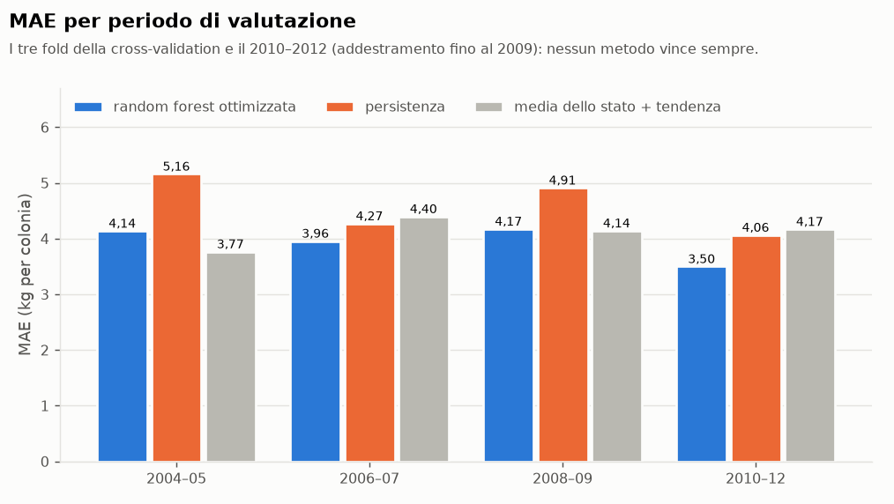
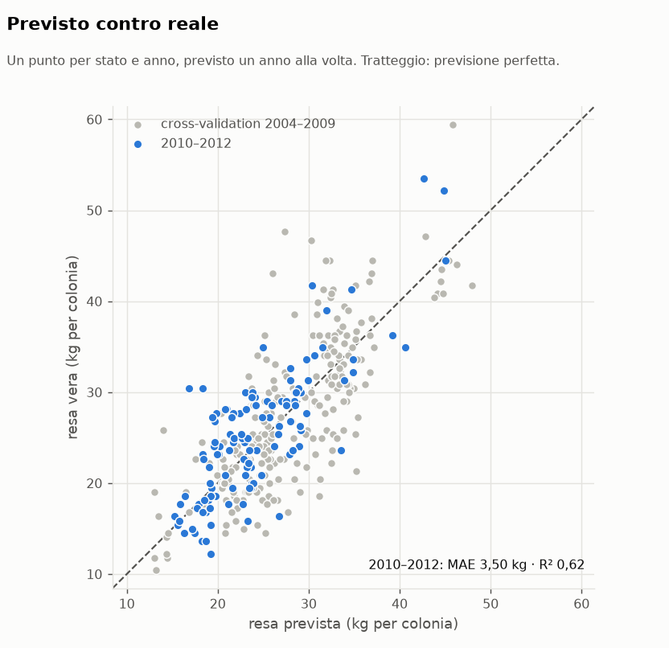
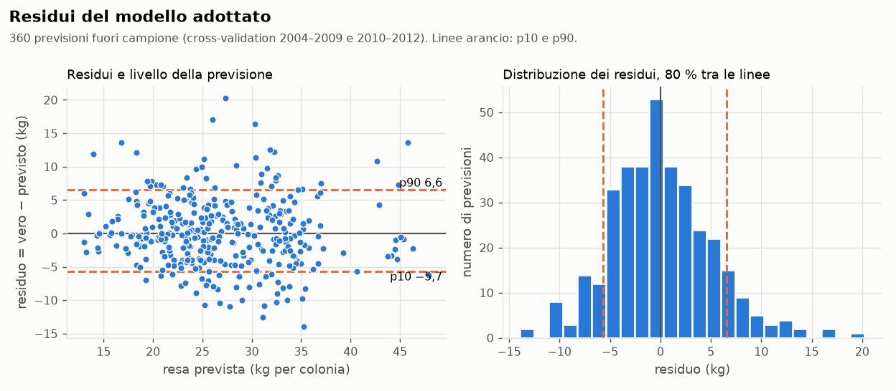
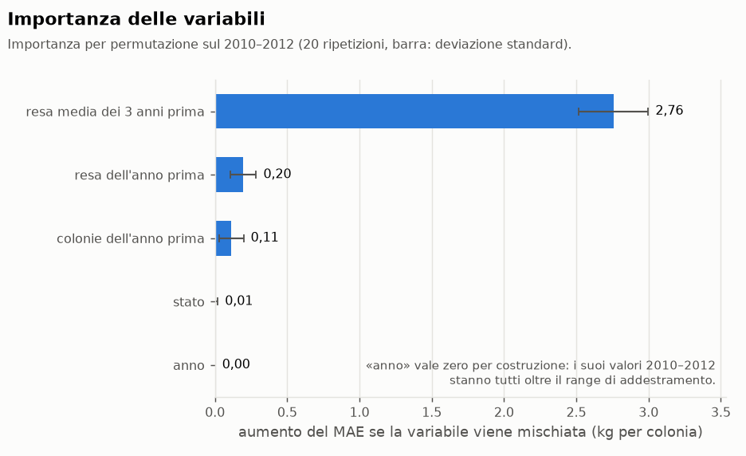
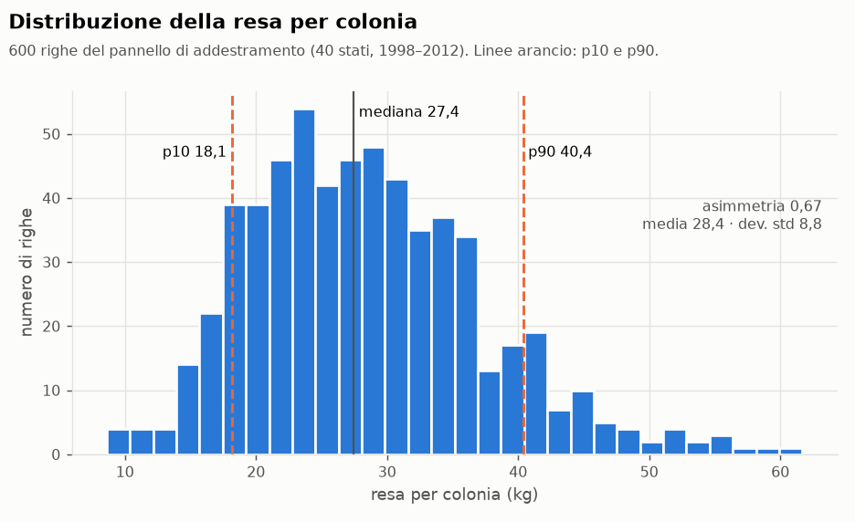

# Model card · Previsione della resa per colonia

> **Stato** in costruzione: dati, validazione e baseline (M4-T1), criterio di
> accettazione (DA-05), feature (M4-T2), confronto fra modelli (M4-T3),
> cross-validation temporale (M4-T4), tuning (M4-T5), valutazione finale (M4-T6).
> Il salvataggio del modello e il servizio di previsione arrivano con M4-T7 e M4-T8.
> **Codice** `beewatch/ml/train.py`, `beewatch/ml/features.py`, `beewatch/ml/validazione.py`, `beewatch/ml/tuning.py`, `beewatch/ml/valutazione.py`, `scripts/genera_grafici.py` · **Notebook** `notebooks/02_modelli.ipynb` · **Test** `tests/test_train.py`, `tests/test_features.py`, `tests/test_confronto_modelli.py`, `tests/test_validazione.py`, `tests/test_tuning.py`, `tests/test_valutazione.py`, `tests/test_grafici.py`

## Che cosa prevede

La **resa per colonia** (`resa_per_colonia_kg`, chili di miele per colonia in un
anno) di uno stato USA, a partire dalla sua storia. È il target scelto in M2-T3:
l'unica grandezza biologica del dataset, indipendente dalla scala. Il modello
non conosce il singolo alveare dell'utente (vedi i limiti in
[`dati.md`](markdown/M2-dati/dati.md)).

## Dati

| | |
|---|---|
| Sorgente | tabella `produzione_usda` di MySQL, query **Q8** (`ProduzioneUsdaRepository.dati_addestramento`); il CSV non viene mai letto dal codice di ML |
| Origine | `data/honeyproduction.csv`, USDA/NASS via Kaggle, CC0, SHA-256 `70a831b5…ed038e` ([scheda](../data/README.md)), caricato con `python scripts/run_etl.py` |
| Pannello | **40 stati con tutti i 15 anni (1998–2012), 600 righe**. I 4 stati con serie incompleta (MD, NV, OK, SC) restano nel database ma fuori dall'addestramento (regola R10) |
| Colonne | `codice_stato`, `anno`, `numero_colonie`, `resa_per_colonia_kg` |

## Validazione

**Hold-out temporale**: addestramento 1998–2009 (**480 righe**), verifica
2010–2012 (**120 righe**, gli stessi 40 stati). È la divisione di M2-T3. Uno
split casuale metterebbe nell'addestramento anni successivi a quelli da
prevedere: con dati che hanno una tendenza nel tempo, e con feature che useranno
l'anno precedente, sarebbe informazione dal futuro.

Ogni previsione riguarda **un anno alla volta**: per l'anno *t* si usa solo ciò
che si sa alla fine dell'anno *t − 1*.

Dentro l'addestramento c'è anche una **cross-validation temporale** per anno
(M4-T4), descritta più sotto: tre fold che valutano il 2004–2009.

**Il 2010–2012 non è più una verifica del tutto indipendente**: in M4-T3 è
servito a confrontare i modelli e a sceglierne uno. I suoi numeri restano il
riferimento di DA-05, ma una stima del tutto imparziale dell'errore su anni nuovi
non c'è: il dataset finisce nel 2012.

## Baseline

Le metriche vengono tutte dalla stessa funzione (`metriche()`), quella che
valuterà anche i modelli. Valori sulla verifica 2010–2012, kg per colonia:

| Baseline | Definizione | MAE | RMSE | R² |
|---|---|---|---|---|
| Media globale | resa media dell'addestramento | 6,655 | 8,371 | −0,313 |
| Media dello stato | resa media dello stato nell'addestramento | 5,727 | 6,798 | 0,134 |
| Media dello stato + tendenza annuale | media dello stato + pendenza comune × (anno − anno medio dello stato); pendenza stimata con i minimi quadrati sugli scarti dalla media del proprio stato: **−0,533 kg/anno** | 4,168 | 5,435 | 0,447 |
| **Persistenza** | resa dello stesso stato nell'anno precedente | **4,063** | **5,296** | **0,474** |

La baseline più forte è la **persistenza**: chi prevede «come l'anno scorso»
sbaglia in media di 4,06 kg.

### Confronto con M2-T3

M2-T3 aveva misurato le stesse baseline su **tutte le 626 righe** (44 stati,
addestramento di 506 righe). Rifatte con questo codice su quelle righe:

| Baseline | M2-T3 | Questo codice, 626 righe | Questo codice, pannello Q8 |
|---|---|---|---|
| Media globale | 6,46 | 6,46 | 6,66 |
| Media dello stato | 5,73 | 5,73 | 5,73 |
| Media dello stato + tendenza | 4,25 | 4,17 | 4,17 |
| Persistenza | — (4,06 nella verifica del 6 ottobre) | 4,06 | 4,06 |

- La **media globale** cambia fra 626 e 600 righe perché i 4 stati esclusi
  pesano sulla media; la verifica è la stessa.
- La **tendenza** non coincide con il 4,25 di M2-T3 perché M2-T3 non scrive
  come stimava la pendenza. Con una retta stimata su tutte le righe insieme,
  senza togliere prima la media di ogni stato, sulle 626 righe si ottiene 4,26.
  Questo codice toglie la media dello stato, il modo corretto quando gli stati
  hanno livelli diversi. Sul pannello Q8, che è bilanciato, i due metodi danno
  lo stesso valore: 4,17.

Gli stessi numeri sono controllati da test di integrazione sul database
(`tests/test_train.py`).

## Criterio di accettazione (DA-05)

Un modello soddisfa il criterio prestazionale **soltanto se**
`MAE_modello < MAE_persistenza`, con le due metriche calcolate da `metriche()`
sulle stesse 120 righe di verifica (2010–2012) del pannello Q8, sullo stesso
target. Il confronto usa i valori **non arrotondati**: la persistenza vale
**4,063428333… kg** (487,6114 kg di errore su 120 righe), e un modello che si
scrive «4,06» può stare sopra o sotto. Nel codice: `soddisfa_criterio()`.

| Soglia | Valore | Ruolo |
|---|---|---|
| battere la persistenza (DA-05) | MAE < 4,063428… kg | **criterio** |
| M2-T3 | MAE < 4,25 kg | riferimento storico: da sola non basta |

Motivazione e coerenza con la specifica:
[`DA-05_criterio_di_accettazione.md`](markdown/M4-machine-learning/DA-05_criterio_di_accettazione.md).
Se nessun modello batte la persistenza, questa model card lo dirà senza
indicare un vincitore.

## Feature

Costruite da `costruisci_feature_storiche()` (i valori degli anni precedenti
dello stesso stato, cercati per chiave) e trasformate da `crea_preprocessore()`,
il `ColumnTransformer` in testa a ogni Pipeline. Ogni feature della riga
(stato, anno *t*) usa solo ciò che si sa alla fine dell'anno *t − 1*.

| Feature | Trasformazione | Perché |
|---|---|---|
| `codice_stato` | one-hot (stato nuovo → tutti zeri) | il livello di resa dello stato |
| `anno` | standardizzato | la tendenza, −0,53 kg l'anno |
| `resa_anno_prima` | mediana se manca, standardizzata | la persistenza, la baseline più forte |
| `resa_media_3_anni_prima` | mediana se manca, standardizzata | un livello recente meno rumoroso di un anno solo |
| `colonie_anno_prima` | `log1p`, mediana se manca, standardizzata | la scala dell'apicoltura dello stato (da 2.000 a 510.000 colonie) |
| `senza_storia` | indicatore | 1 nel primo anno di uno stato (1998), dove le tre feature storiche sono imputate |

**Escluse:** il target dell'anno; `numero_colonie` dello stesso anno (non si
conosce alla fine dell'anno prima); `produzione_totale_kg` e
`valore_produzione_usd` (contengono il target, R5); `scorte_kg` e
`prezzo_per_kg_usd` (mercato, M2-T3; non sono in Q8). Il preprocessore scarta
ogni colonna che non è una feature.

Mediane, medie e scale si imparano solo dalle righe di addestramento. Sulla
verifica 2010–2012 nessuna feature storica manca, e `resa_anno_prima` coincide
con la previsione della persistenza. Motivazioni:
[`M4-T2_feature_preprocessore.md`](markdown/M4-machine-learning/M4-T2_feature_preprocessore.md).

## Confronto fra modelli (M4-T3)

Tre Pipeline con lo stesso preprocessore (M4-T2) e tre regressori con gli
iperparametri di default (il tuning è di M4-T5): **regressione lineare**
(`LinearRegression`), **albero di decisione** (`DecisionTreeRegressor`),
**random forest** (`RandomForestRegressor`, 100 alberi); `random_state = 42`.
Codice: `crea_modelli()` e `confronta_modelli()` in `train.py`.

Tutte le righe della tabella vengono dallo stesso `Confronto`: addestramento
1998–2009 (480 righe), verifica **2010–2012, le stesse 120 righe** per modelli e
baseline, stessa funzione `metriche()`. Kg per colonia:

| | Tipo | MAE | RMSE | R² | DA-05 |
|---|---|---|---|---|---|
| **Random forest** | modello | **3,6558** | **4,5698** | **0,6088** | ✅ soddisfa |
| Regressione lineare | modello | 4,0254 | 5,3358 | 0,4666 | ✅ soddisfa |
| Persistenza | baseline | 4,0634 | 5,2964 | 0,4745 | riferimento |
| Media dello stato + tendenza | baseline | 4,1681 | 5,4350 | 0,4466 | — |
| Albero di decisione | modello | 5,5792 | 6,8581 | 0,1189 | ❌ non soddisfa |
| Media dello stato | baseline | 5,7272 | 6,7982 | 0,1342 | — |
| Media globale | baseline | 6,6546 | 8,3711 | −0,3128 | — |

**Il criterio DA-05, sui valori non arrotondati** (MAE):

| Modello | MAE | MAE − persistenza (4,063428333…) | Esito |
|---|---|---|---|
| Random forest | 3,655800750 | −0,407628 | soddisfa |
| Regressione lineare | 4,025411865 | −0,038016 | soddisfa, di poco |
| Albero di decisione | 5,579183333 | +1,515755 | non soddisfa |

**Anno per anno** (MAE; media e deviazione standard dei tre anni). Il criterio si
decide sulle 120 righe insieme; questa tabella dice quanto il risultato è stabile:

| | 2010 | 2011 | 2012 | media ± dev. std |
|---|---|---|---|---|
| Random forest | 3,499 | 3,387 | 4,082 | 3,656 ± 0,373 |
| Regressione lineare | 4,418 | 3,964 | 3,694 | 4,025 ± 0,366 |
| Persistenza | 4,048 | 4,604 | **3,538** | 4,063 ± 0,533 |
| Media dello stato + tendenza | 4,568 | 4,049 | 3,888 | 4,168 ± 0,355 |
| Albero di decisione | 5,182 | 5,160 | 6,396 | 5,579 ± 0,707 |

La «media ± deviazione standard» chiesta dal backlog qui è fra i tre anni di
verifica; quella fra le pieghe della cross-validation temporale arriva con M4-T4.

**Sensibilità al seed** (informativa, non usata per scegliere): con i seed 0–9 la
random forest va da 3,613 a 3,778 di MAE, sempre sotto la persistenza; l'albero
da 5,213 a 5,511. La regressione lineare non ha casualità.

### Scelta

**Random forest.** È il solo modello che batte la persistenza con un margine
chiaro (−0,41 kg, il 10 %), su tutte e tre le metriche, e il margine regge con
tutti i seed provati. La regressione lineare soddisfa DA-05 ma per 0,038 kg, e
perde con la persistenza nel 2010 e nel 2012. L'albero singolo fa peggio di
persistenza e tendenza, appena meglio della media dello stato: con gli
iperparametri di default cresce senza limiti di profondità, e probabilmente
impara il rumore dell'addestramento (il tuning di M4-T5 lo verificherà).

Cosa questa scelta **non** dimostra:

- la verifica 2010–2012 è servita anche a scegliere, quindi il 3,656 è un po'
  ottimista; la cross-validation temporale sull'addestramento (M4-T4) dirà se il
  vantaggio regge su altri anni (esito più sotto: regge sulla persistenza, non
  sulla baseline con la tendenza);
- nel 2012 la persistenza (3,538) fa meglio di tutti i modelli: il vantaggio è
  sulla media dei tre anni, non su ogni anno;
- 120 righe sono poche: differenze di qualche centesimo, come quella della
  regressione lineare, non sono distinguibili dal caso.

Il funzionamento tecnico (stesse righe, nessuna informazione dal futuro, seed
riproducibile) è verificato dai test; il risultato prestazionale è quello della
tabella. Il notebook `notebooks/02_modelli.ipynb` rifà il confronto dal database
richiamando `train.py`. Motivazioni:
[`M4-T3_confronto_modelli.md`](markdown/M4-machine-learning/M4-T3_confronto_modelli.md).

## Validazione temporale (M4-T4)

### Strategia

**Cross-validation a finestra espandente, per anno, solo sull'addestramento**
(`cross_validation_temporale()` in `beewatch/ml/validazione.py`). Tre fold,
fissati dal backlog prima di guardare i risultati:

| Fold | Addestramento | Valutazione | Righe di valutazione |
|---|---|---|---|
| 1 | 1998–2003 (240 righe) | 2004–2005 | 80 |
| 2 | 1998–2005 (320 righe) | 2006–2007 | 80 |
| 3 | 1998–2007 (400 righe) | 2008–2009 | 80 |

Ogni fold è lo stesso confronto di M4-T3 (`confronta_modelli`), sui dati fino
all'ultimo anno di valutazione: stesse Pipeline, stesse feature, stesse baseline,
stessa funzione `metriche()`, seed 42. Il preprocessore impara mediane e scale
solo dall'addestramento del fold; le baseline usano solo l'addestramento del fold
(la persistenza, la resa dell'anno prima della riga). Gli anni dopo la
valutazione non sono nel DataFrame del fold, e nessun fold arriva al 2010–2012.

**Perché non uno split casuale.** Le righe dello stesso anno finirebbero in parte
nell'addestramento e in parte nella valutazione, e anni successivi a quelli da
prevedere starebbero nell'addestramento. Con una resa che cala nel tempo, il
modello imparerebbe il livello di anni che dovrebbe ancora ignorare; con le
feature dell'anno prima, la resa vera di una riga di valutazione sarebbe la
feature di una riga di addestramento dell'anno dopo. L'errore misurato sarebbe
più basso di quello che si avrà davvero prevedendo un anno nuovo.

**Perché non `TimeSeriesSplit`.** Taglia le righe, non gli anni: con 40 stati per
anno un confine cadrebbe a metà di un anno. `fold_temporali()` dà gli indici per
anno nella forma del parametro `cv` di scikit-learn (servirà a M4-T5).

### Risultati per fold

MAE in kg per colonia (in grassetto il migliore del fold):

| | Fold 1 · 2004–05 | Fold 2 · 2006–07 | Fold 3 · 2008–09 |
|---|---|---|---|
| Random forest | 4,1389 | **4,1783** | **4,0962** |
| Regressione lineare | 3,9996 | 4,4533 | 4,1897 |
| Albero di decisione | 6,0838 | 5,1086 | 5,9307 |
| Persistenza | 5,1596 | 4,2694 | 4,9101 |
| Media dello stato + tendenza | **3,7657** | 4,3961 | 4,1400 |
| Media dello stato | 4,0993 | 4,8931 | 5,3342 |
| Media globale | 7,1228 | 6,9387 | 7,1867 |

RMSE e R² per fold:

| | Fold 1 RMSE · R² | Fold 2 RMSE · R² | Fold 3 RMSE · R² |
|---|---|---|---|
| Random forest | 5,5478 · 0,6051 | 5,1959 · 0,5417 | 5,0394 · 0,5892 |
| Regressione lineare | 5,3243 · 0,6363 | 5,5419 · 0,4786 | 5,4665 · 0,5166 |
| Albero di decisione | 8,2451 · 0,1277 | 6,2829 · 0,3298 | 7,5004 · 0,0900 |
| Persistenza | 6,4952 · 0,4587 | 5,6510 · 0,4579 | 6,1737 · 0,3835 |
| Media dello stato + tendenza | 5,0693 · 0,6703 | 5,5696 · 0,4734 | 5,4245 · 0,5240 |
| Media dello stato | 5,0765 · 0,6693 | 6,1286 · 0,3624 | 6,5174 · 0,3129 |
| Media globale | 8,9089 · −0,0184 | 8,0919 · −0,1116 | 8,6425 · −0,2082 |

### Media e deviazione standard sui tre fold

Deviazione standard campionaria (n − 1):

| | MAE | RMSE | R² | Fold sotto la persistenza |
|---|---|---|---|---|
| Random forest | 4,1378 ± 0,0410 | 5,2610 ± 0,2604 | 0,5787 ± 0,0330 | 3 su 3 |
| Regressione lineare | 4,2142 ± 0,2279 | 5,4443 ± 0,1105 | 0,5438 ± 0,0823 | 2 su 3 |
| Albero di decisione | 5,7077 ± 0,5245 | 7,3428 ± 0,9905 | 0,1825 ± 0,1290 | 0 su 3 |
| Media dello stato + tendenza | **4,1006 ± 0,3170** | 5,3544 ± 0,2574 | 0,5559 ± 0,1022 | baseline |
| Persistenza | 4,7797 ± 0,4592 | 6,1067 ± 0,4261 | 0,4333 ± 0,0432 | baseline |
| Media dello stato | 4,7756 ± 0,6258 | 5,9075 ± 0,7454 | 0,4482 ± 0,1931 | baseline |
| Media globale | 7,0827 ± 0,1288 | 8,5478 ± 0,4166 | −0,1127 ± 0,0949 | baseline |

### Che cosa dicono

**Risultati sul pannello 2010–2012 (M4-T3, invariati).** Random forest 3,6558
contro persistenza 4,063428333…: DA-05 soddisfatto. Quel pannello è servito anche
a scegliere.

**Risultati della cross-validation (M4-T4).**

- La random forest batte la persistenza **in tutti e tre i fold** (di 1,02, 0,09
  e 0,81 kg), ed è il modello più **stabile**: deviazione standard del MAE 0,04,
  contro 0,23 della regressione lineare e 0,52 dell'albero. Ha anche il RMSE e
  l'R² medi migliori di tutta la tabella.
- Ma sul MAE medio **non batte la baseline «media dello stato + tendenza»**:
  4,1378 contro 4,1006. Nel fold 1 la tendenza è la migliore di tutte (3,77),
  nei fold 2 e 3 vince la random forest. La differenza media, 0,04 kg, è molto
  più piccola della variabilità fra fold della baseline (0,32).
- Negli anni 2004–2009 la persistenza non è la baseline più forte: la tendenza
  e, nel fold 1, la media dello stato fanno meglio. Nel 2010–2012 era il
  contrario.

**Stabilità e generalizzazione.** Il vantaggio della random forest sulla
persistenza regge su anni diversi da quelli usati per sceglierla. Che la random
forest sia migliore di **ogni** metodo semplice **non è dimostrato**: sul MAE
medio è alla pari con la baseline con la tendenza, e quale baseline è la più
forte cambia da un periodo all'altro.

**DA-05 non cambia.** Il criterio resta quello deciso (persistenza, pannello
2010–2012, valori non arrotondati) ed è soddisfatto; la cross-validation non lo
sostituisce, dice quanto quel risultato è stabile.

### Limiti della procedura

- Il fold 1 addestra su 6 anni, uno dei quali (1998) senza storia: è il fold con
  meno informazione, e quello in cui le baseline semplici vanno meglio.
- 80 righe per fold e tre fold: medie e deviazioni standard sono indicative, non
  test statistici.
- Feature, modelli e fold sono stati fissati prima di questi risultati; la
  scelta della random forest invece è stata fatta sul 2010–2012 (M4-T3), che
  quindi non è più una verifica indipendente.
- Quindici anni in tutto: dopo il 2012 non ci sono dati per una verifica finale
  su anni mai visti.

### Verifica da parte di una seconda persona

La DoD chiede che una seconda persona controlli che non ci sia informazione dal
futuro. **Fatta, esito positivo**: revisore DEV-2, sul codice di `main` al commit
`a4404fd`, punti 1–5 compresa l'ipotesi delle previsioni sequenziali a un anno
(issue #21). I punti controllati:

- in `confronta_modelli` (`train.py`) il target è tolto dagli ingressi e il
  preprocessore è adattato con `fit` solo sull'addestramento;
- in `costruisci_feature_storiche` (`features.py`) ogni feature usa anni
  strettamente precedenti a quello della riga;
- in `cross_validation_temporale` (`validazione.py`) ogni fold riceve solo i dati
  fino al suo ultimo anno di valutazione, e nessun fold va oltre il 2009;
- i test `test_gli_anni_dopo_la_valutazione_non_cambiano_il_fold`,
  `test_lhold_out_2010_2012_non_entra_nella_cross_validation` e
  `test_nel_fold_i_modelli_non_vedono_la_resa_che_devono_prevedere`.

Dettagli: [`M4-T4_validazione_temporale.md`](markdown/M4-machine-learning/M4-T4_validazione_temporale.md).

## Tuning (M4-T5)

### Griglia e procedura

`ottimizza_random_forest()` in `beewatch/ml/tuning.py`: un `GridSearchCV` sulla
Pipeline della random forest (stesso preprocessore, seed 42), con
`scoring="neg_mean_absolute_error"` (il MAE è la metrica di DA-05) e come `cv` i
tre fold per anno di M4-T4 (`fold_temporali`). Il dataset viene ristretto agli
anni **fino al 2009 prima** di costruire feature e indici: il 2010–2012 non entra
nella ricerca né in questa task.

| Iperparametro | Valori | Perché |
|---|---|---|
| `n_estimators` | 200, 500 | più alberi riducono la varianza della media; oltre qualche centinaio il guadagno è trascurabile |
| `max_depth` | None, 8, 15 | alberi interi o limitati: con 240–400 righe di addestramento per fold il rischio è imparare il rumore |
| `min_samples_leaf` | 1, 3, 5 | foglie più grandi fanno medie su più righe: previsioni più lisce, meno sovradattamento |

18 configurazioni × 3 fold. La griglia è quella del backlog; nessun valore è stato
aggiunto dopo aver visto i risultati.

**Regole fissate prima della ricerca:**

- si sceglie la configurazione con il MAE medio più basso sui tre fold;
- default e configurazione scelta si rivalutano con `cross_validation_temporale`:
  stessi fold, stesse righe, stessa `metriche()`;
- la scelta si adotta solo se ha un MAE medio più basso dei default **e** migliora
  in almeno due fold su tre (`EsitoTuning.da_adottare`); altrimenti restano i
  default.

### Risultati

Configurazione scelta: **`n_estimators=200`, `max_depth=None`,
`min_samples_leaf=5`**. Le sei configurazioni migliori hanno tutte
`min_samples_leaf=5`; la profondità cambia poco (4,0883 / 4,0885 / 4,0922 con
200 alberi).

MAE per fold, kg per colonia:

| | 2004–05 | 2006–07 | 2008–09 | Media ± std |
|---|---|---|---|---|
| Random forest, default | 4,1389 | 4,1783 | 4,0962 | 4,1378 ± 0,0410 |
| Random forest, ottimizzata | 4,1365 | 3,9563 | 4,1723 | 4,0883 ± 0,1158 |
| Differenza (ottimizzata − default) | −0,0024 | −0,2220 | +0,0760 | −0,0495 |

Media ± deviazione standard sui tre fold:

| | MAE | RMSE | R² |
|---|---|---|---|
| Random forest, default | 4,1378 ± 0,0410 | **5,2610** ± 0,2604 | **0,5787** ± 0,0330 |
| Random forest, ottimizzata | **4,0883** ± 0,1158 | 5,3225 ± 0,3015 | 0,5685 ± 0,0421 |
| Media dello stato + tendenza | 4,1006 ± 0,3170 | 5,3544 ± 0,2574 | 0,5559 ± 0,1022 |
| Persistenza | 4,7797 ± 0,4592 | 6,1067 ± 0,4261 | 0,4333 ± 0,0432 |

(La colonna «mae_dev_std» di `GridSearchCV` usa la deviazione standard con n,
0,0945 per la scelta; qui è con n − 1, come in M4-T4.)

### Il miglioramento, detto onestamente

**Il tuning migliora il MAE medio di 0,049 kg (1,2 %), e niente di più.**

- La regola di adozione è soddisfatta, ma di poco: dei due fold migliorati uno
  lo è per 0,002 kg, cioè alla pari; nel 2008–09 l'ottimizzata peggiora di 0,076.
- RMSE e R² medi **peggiorano**, e la variabilità fra fold quasi triplica (0,041 →
  0,116). Foglie più grandi rendono le previsioni più lisce: l'errore tipico cala
  un poco, gli errori grandi probabilmente crescono (nel 2008–09 il RMSE passa da
  5,04 a 5,43).
- La configurazione è la migliore di 18 **sugli stessi fold** su cui è misurata:
  il 4,0883 è ottimista. Con tre fold una cross-validation annidata non darebbe
  stime affidabili, e non è stata fatta.
- Rispetto alla baseline «media dello stato + tendenza» (4,1006) l'ottimizzata è
  sotto di 0,012 kg: è ancora alla pari, non un vantaggio.

**Decisione.** Per la regola fissata prima, la configurazione ottimizzata
(`n_estimators=200`, `min_samples_leaf=5`) diventa quella della valutazione
finale (M4-T6) e del salvataggio (M4-T7). Il guadagno resta nell'ordine del
rumore: tornare ai default sarebbe altrettanto difendibile.

**Cosa il tuning non dice.** Non è stato misurato sul 2010–2012, che resta fuori
da M4-T5. Questo non rende quel pannello una verifica indipendente: è già stato
usato per scegliere il modello in M4-T3.

Dettagli: [`M4-T5_tuning.md`](markdown/M4-machine-learning/M4-T5_tuning.md).

## Valutazione finale (M4-T6)

### Il modello adottato

**Random forest** con `n_estimators=200`, `max_depth=None`, `min_samples_leaf=5`,
`random_state=42`, dietro il preprocessore di M4-T2 (`crea_modello_finale()` in
`train.py`). La famiglia di modelli è stata scelta in M4-T3 guardando il 2010–2012; gli
iperparametri in M4-T5 con la sola cross-validation 2004–2009, applicando la regola di
adozione fissata prima della ricerca. Nessun parametro è stato cambiato dopo aver visto i
risultati di questa sezione.

Tutti i numeri qui sotto vengono da `beewatch.ml.valutazione.valuta_finale` sul pannello
Q8 letto da MySQL (`tests/test_valutazione.py` li controlla dal database) e i grafici da
`python scripts/genera_grafici.py`.

### Risultati misurati

**Sul 2010–2012**, 120 righe, addestramento fino al 2009, kg per colonia (la verifica di
DA-05):

| | MAE | RMSE | R² | DA-05 |
|---|---|---|---|---|
| **Random forest ottimizzata** | **3,4986** | **4,4826** | **0,6236** | ✅ −0,5648 sotto la persistenza |
| Random forest di default (M4-T3) | 3,6558 | 4,5698 | 0,6088 | ✅ −0,4076 |
| Persistenza | 4,063428… | 5,2964 | 0,4745 | riferimento |
| Media dello stato + tendenza | 4,1681 | 5,4350 | 0,4466 | |
| Media dello stato | 5,7272 | 6,7982 | 0,1342 | |
| Media globale | 6,6546 | 8,3711 | −0,3128 | |

Il MAE del modello adottato è anche sotto la soglia storica di M2-T3 (4,25 kg), che da sola
non dimostrava niente: il criterio vincolante è la persistenza.

**Sulla cross-validation 2004–2009**, tre fold, media ± deviazione standard (M4-T4, M4-T5):

| | MAE | RMSE | R² |
|---|---|---|---|
| **Random forest ottimizzata** | **4,0883 ± 0,1158** | 5,3225 ± 0,3015 | 0,5685 ± 0,0421 |
| Media dello stato + tendenza | 4,1006 ± 0,3170 | 5,3544 ± 0,2574 | 0,5559 ± 0,1022 |
| Persistenza | 4,7797 ± 0,4592 | 6,1067 ± 0,4261 | 0,4333 ± 0,0432 |
| Media dello stato | 4,7756 ± 0,6258 | 5,9075 ± 0,7454 | 0,4482 ± 0,1931 |
| Media globale | 7,0827 ± 0,1288 | 8,5478 ± 0,4166 | −0,1127 ± 0,0949 |

### Che cosa si può concludere, e che cosa no

| Misurato | Conclusione che regge | Conclusione che non regge |
|---|---|---|
| MAE 3,50 kg sul 2010–2012 e 4,09 kg in cross-validation; R² 0,62 e 0,57 | l'errore tipico è di circa 3,5–4 kg per colonia, su una resa media di 28,4 kg | «il modello è accurato al X %» (non esiste in una regressione) |
| Sotto la persistenza in tutti e quattro i periodi (tre fold e 2010–2012) | il modello batte la persistenza in modo costante, sui dati che abbiamo | che batta la persistenza su anni o stati che non abbiamo |
| Alla pari con «media dello stato + tendenza» in cross-validation (−0,012 kg), meglio nel 2006–07 e nel 2010–12, peggio nel 2004–05 e nel 2008–09 | nessun vantaggio solido su una retta per stato | che serva un modello di machine learning invece di due medie e una retta |
| Il 2010–2012 migliora di 0,157 kg con il tuning, la cross-validation di 0,049 | il tuning non ha peggiorato il modello | che il tuning valga 0,16 kg: tre anni sono pochi, e la cifra più prudente è la seconda |
| R² del mockup 0,87 | — | è un valore illustrativo, non replicato né promesso; l'atteso realistico era 0,4–0,6 |

**Il 2010–2012 non è un test indipendente.** Ha servito a scegliere la famiglia di modelli
(M4-T3). Il tuning non l'ha visto, e gli errori su quegli anni sono veri errori fuori
campione, ma la scelta li ha visti: i 3,50 kg sono una stima un po' ottimista. La
cross-validation 2004–2009 è l'unica misura che non ha scelto il tipo di modello, ma ha
scelto gli iperparametri. Non esiste una verifica del tutto imparziale: il dataset finisce
nel 2012.

**La generalizzazione non è dimostrata.** I dati sono commerciali, aggregati per stato e
fermi al 2012: il modello è stabile fra periodi diversi di quegli stessi dati, e questo è
tutto quello che le misure permettono di dire.

### Residui

Residuo = valore vero − previsto, in kg per colonia (positivo se il modello sottostima).
360 previsioni fuori campione: 240 della cross-validation e 120 del 2010–2012, ognuna
fatta da un modello che non l'ha vista.

- **Errore medio con segno:** −0,31 kg in cross-validation, **+0,96 kg** sul 2010–2012
  (sottostima di circa un chilo in quegli anni, in 66 righe su 120). Mediana dei residui
  −0,32 kg.
- **Coda a destra:** asimmetria dei residui 0,44; da −13,9 a +20,3 kg. Gli errori
  grandi sono più spesso sottostime: oltre i 10 kg se ne contano 13 contro 7 sovrastime.
- **Per anno:** il MAE va da 3,27 (2011) a 4,25 kg (2009); il segno dell'errore cambia da un
  anno all'altro.
- **Per stato:** il MAE va da 1,79 (VA) a 7,40 kg (SD), mediana 3,73; con 9 anni per
  stato sono stime rumorose. **Mississippi** è sottostimato in modo sistematico (errore
  medio +6,04 kg).
- **Per livello della previsione:** l'errore cresce con la resa prevista.

  | Fascia (terzili) | Previsto medio | MAE | Ampiezza p10–p90 dei residui |
  |---|---|---|---|
  | bassa | 19,9 kg | 3,12 | 10,4 kg |
  | media | 26,0 kg | 3,93 | 11,7 kg |
  | alta | 34,4 kg | 4,62 | 14,8 kg |

### Intervallo di previsione

L'intervallo si costruisce sui quantili **p10 e p90 dei residui fuori campione**: l'80 %
degli errori osservati sta dentro. Estremi: `previsto + p10` e `previsto + p90`.

| | p10 | p90 | Ampiezza |
|---|---|---|---|
| Calibrato sulla sola cross-validation (240 residui) | −6,52 kg | +6,15 kg | 12,67 kg |
| **Finale**, su tutti i 360 residui (quello che userà il servizio) | **−5,71 kg** | **+6,58 kg** | 12,30 kg |

- **Controllo onesto della promessa «80 %»:** l'intervallo calibrato sulla sola
  cross-validation copre l'**85 %** dei residui del 2010–2012, che non hanno contribuito a
  costruirlo. Copre di più del 80 % perché in quegli anni gli errori sono stati più piccoli
  (MAE 3,50 contro 4,09 kg).
- **Il valore provvisorio di M2-T3 era ± 6 kg:** l'intervallo vero è di ampiezza simile
  (circa 12 kg), leggermente asimmetrico.
- **L'ampiezza costante è una semplificazione.** Con l'intervallo finale la copertura è
  **87 %** per le previsioni basse, **81 %** per le medie e **72,5 %** per le alte (terzile
  più alto, previsto medio 34,4 kg): lì la promessa «80 %» è ottimistica. La pagina dovrà dire «circa l'80 %», non
  «80 %».
- **Regola «se l'intervallo è più largo della stima, la stima non si mostra»:** vale per
  stime sotto i 12,3 kg. Fra le 360 previsioni fuori campione la più bassa è 13,0 kg, quindi
  non sarebbe scattata, ma nei dati la resa scende fino a 8,6 kg.
- **Nessun arrotondamento sotto il chilo** (M2-T3): estremi e stima si mostrano a chili
  interi.

### Importanza delle variabili

Importanza per permutazione sul 2010–2012 (20 ripetizioni, seed 42): di quanti kg peggiora il
MAE se si mischiano i valori di una variabile.

| Variabile | Aumento del MAE (kg) |
|---|---|
| resa media dei tre anni prima | **2,7565** ± 0,2414 |
| resa dell'anno prima | 0,1957 ± 0,0896 |
| colonie dell'anno prima | 0,1133 ± 0,0844 |
| stato | 0,0088 ± 0,0105 |
| anno | 0,0000 ± 0,0000 |

- Il modello è, in sostanza, **«il livello recente dello stato»**: la media degli ultimi tre
  anni pesa oltre quattordici volte l'anno prima. Lo stato come identità aggiunge quasi
  niente oltre ai ritardi.
- **`anno` vale zero per costruzione, non perché sia inutile:** i suoi valori nel 2010–2012
  sono tutti oltre quelli visti in addestramento (fino al 2009), quindi ogni soglia imparata
  manda quelle righe dalla stessa parte, qualunque sia il valore mischiato. La tendenza
  (−0,5 kg l'anno) il modello la porta nei ritardi, non in `anno`. Un test lo verifica.
- **Variabili correlate:** la media dei tre anni e l'anno prima sono molto vicine; mischiarne
  una lascia l'altra a compensare, quindi l'importanza dell'anno prima è sottostimata.

### Il target e lo sbilanciamento

**Lo sbilanciamento delle classi non si applica a una regressione**: il target è un numero
continuo e non ci sono classi da bilanciare. La distribuzione del target è stata comunque
verificata e trattata.

| 600 righe del pannello Q8 | kg per colonia |
|---|---|
| Media / mediana | 28,40 / 27,44 |
| Deviazione standard | 8,83 |
| Minimo – massimo | 8,62 – 61,69 |
| p10 – p90 | 18,14 – 40,37 |
| Asimmetria | 0,67 (0,69 sulle 626 righe) |

La coda a destra è moderata. **Nessuna trasformazione del target**: la foresta predice medie
di valori del target dentro le foglie, quindi resta nell'intervallo osservato e non assume
una distribuzione; l'errore e l'intervallo si esprimono in kg per colonia, e un logaritmo
li renderebbe meno leggibili. Il costo, visibile nei residui, è una coda di sottostime.

Anche il **pannello** va guardato: Q8 è bilanciato per costruzione (40 stati × 15 anni), ma
quattro stati con serie incomplete (MD, NV, OK, SC) restano fuori dall'addestramento
(regola R10 di M2-T2).

### Limiti del modello

1. **Dati commerciali, aggregati e statunitensi** (M2-T3, limiti 1–3). Una riga è la media di
   uno stato intero; l'apicoltura è commerciale e nomade; nessuno stato ha il clima
   italiano. Non descrive un apiario amatoriale.
2. **Epoca ed estrapolazione.** I dati si fermano al 2012. Il modello prevede l'anno *t* dai
   ritardi di *t − 1…t − 3*: serve la resa vera dell'anno prima, quindi il solo anno
   «futuro» che può prevedere è il 2013. Più in là non c'è un ritardo da dare. `anno` esce
   dal range visto e non porta informazione.
3. **Variabili assenti** (M2-T3, limite 5). Niente meteo, forza della famiglia, varroa,
   fioriture: `stato` e ritardi sono proxy grossolane.
4. **Selezione sugli stessi dati.** Il 2010–2012 ha scelto la famiglia di modelli e la
   cross-validation gli iperparametri; 120 e 240 righe, con 40 stati e pochi anni, fanno
   stime rumorose. Nessuna verifica del tutto indipendente.
5. **Nessun vantaggio solido su una baseline semplice.** In cross-validation il modello è alla
   pari con «media dello stato + tendenza».
6. **Intervallo a larghezza costante.** Copre il 72,5 % delle previsioni alte contro l'80 %
   promesso.
7. **Errore diseguale fra stati.** Da 1,8 a 7,4 kg di MAE; il Mississippi è sottostimato di
   6 kg in media.

### Quando non usarlo

- **Per prevedere la produzione di un alveare o di un apiario reale**, italiano o amatoriale,
  né per consigliare quando smielare, nutrire o trattare: il modello non sa niente
  dell'alveare. È una stima di riferimento di tipo statistico.
- **Mostrando un numero secco o una percentuale di accuratezza.** Sempre l'intervallo, e
  «circa l'80 %».
- **Per un anno oltre il 2013**, per stati fuori dai 40 del pannello (MD, NV, OK, SC e
  qualunque stato non statunitense) o con dati dell'anno prima mancanti.
- **Quando l'intervallo è più largo della stima.**
- **Come strumento diagnostico**: non sostituisce un veterinario o un tecnico apistico.

Dettagli e decisioni: [`M4-T6_valutazione_finale.md`](markdown/M4-machine-learning/M4-T6_valutazione_finale.md).

## Da completare

- Salvataggio del modello adottato con i suoi metadati (intervallo, importanza, metriche, hash del dataset) e `Predittore` (M4-T7)
- Servizio di previsione che usa l'intervallo finale e la regola «intervallo più largo della stima» (M4-T8)
